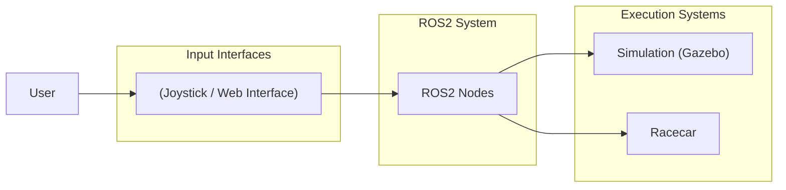
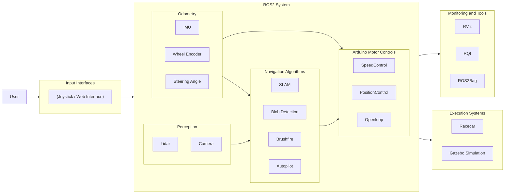
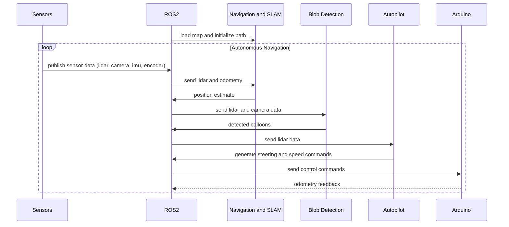
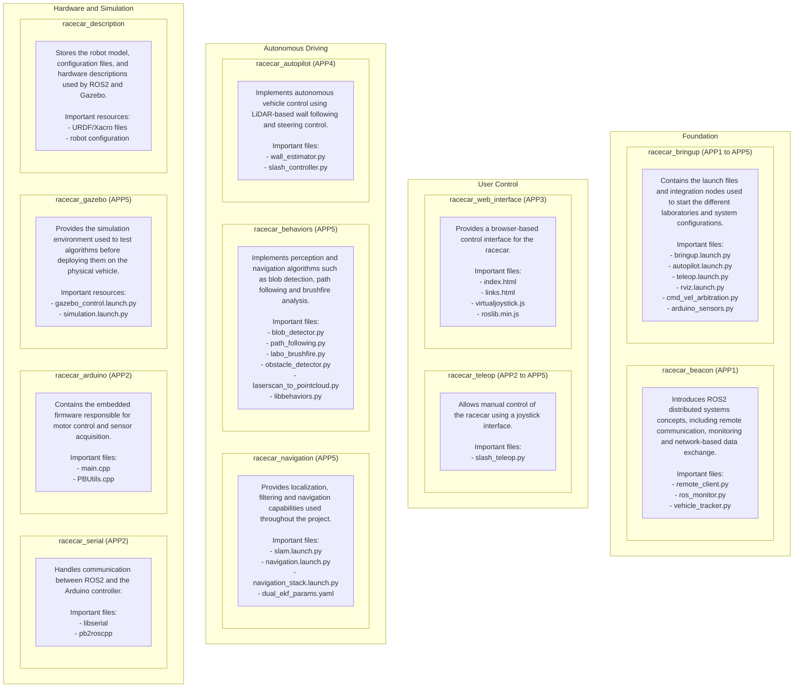
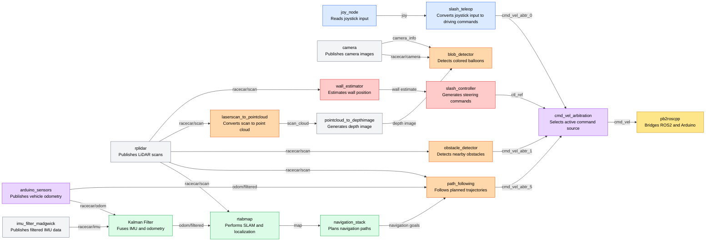

# racecar

Software sources for the UdeS 1/10th autonomous car platform

## Table of contents

* [Technologies](#technologies)
* [Requirements](#requirements)
* [How it works](#how-it-works)
* [Launch](#launch)
* [Controller Modes](#controller-modes)

## Technologies

The project is created with:

* Python 3.8
* Arduino programming language
* [ROS 2](https://docs.ros.org/en/humble/Installation.html)

## Requirements

To be able to test our code, there are a few requirements.

### Hardware

* [RaceCar](https://cad.onshape.com/documents/9d3f435f340b50b281de3ac4/w/60d94a6915ed0711b2290521/e/45c11c7ee9e7e6dfaec5c7e5) of the Université de Sherbrooke
* Logitech Wireless Gamepad F710 (DirectInput Mode)

### Software

* For Raspberry Pi on RaceCar, we provide RPI5 images with everything already installed, see this [page](images/README.md#restore-raspberrypi-image) to flash your RPI.

* For Desktop/Laptop development, see this [section](images/README.md#creating-a-virtual-machine) to setup ROS in a virtual machine or in a dual boot with Ubuntu 24.04

* Click here to [download the default virtual machine](https://usherbrooke.sharepoint.com/:u:/s/genie-robotique-montage/IQBziR3UqTC4RLEV-InRo3QyASJViTz5hc1ibc5v5FGeuy0?e=O65S3v), see this [section](images/README.md#importing-a-virtual-machine) for how to import it in Virtual box
    Use the VM to show topics and view them in RVIZ to limit the usage of the RaspberryPi. You might need to change the [ROS_DOMAIN_ID](https://docs.ros.org/en/rolling/Concepts/Intermediate/About-Domain-ID.html) on both machine before using it : `export ROS_DOMAIN_ID = X`
* As the racecar repository is still under continuous development, we recommand to pull the code at least once before starting any new project as the source code might be more up to date than the version available on a RPI5 image.

### Documentation

* [Architecture Diagrams](doc/architecture/README.md#architecture-diagram)
* [Hardware Connections](doc/README.md#hardware-connections)
* [USB Hub woes](doc/README.md#usb-hub-woes)
* [Steering Offset](doc/README.md#steering-offset)
* [Remote Connection (SSH/XRDP)](doc/README.md#remote-connection-sshxrdp)
* [ROS2 on multiple computers (ROS_IP)](doc/README.md#ros-on-multiple-computers-ros_ip)
* [Simulated environment (Gazebo)](doc/README.md#simulated-environment-gazebo)
* [The RaceCar batteries](doc/README.md#the-racecar-batteries)
* [Charging the Anker battery](doc/README.md#charging-the-anker-battery)
* [Charging the Traxxas battery](doc/README.md#charging-the-traxxas-battery)
* [The Killswitch](doc/README.md#the-killswitch)

## How it works

In the graph, you can see a representation of the communication between the nodes and the topics of the most basic working mode:


using the base launch file with:

```bash
$ ros2 launch racecar_bringup basic_control.launch.py
$ rqt_plot
```

The RaceCar has many operating modes that allow you to test different functionnalities. The ROS controller Node, which control commands to the motor and the steering servo, has multiple high-level mode that are selected by joystick inputs (see [Controller modes](#controller-modes) table for more details). For instance, open-loop, closed-loop in velocity, closed-loop in position modes are available for both the propulsion and the steering.  The Arduino has also multiple internal low-level modes (different than the high-level ones!!!) that are selected by the ROS controller Node. Empty operating mode templates are available in the source code for you to test custom control modes.

## Launch

1. Follow those [instructions](images#restore-raspberrypi-image) to flash your Raspberry Pi with a pre-built image.
2. Connect the battery to Raspberry Pi.
3. Flash the Arduino (need to be done only 1 time):
    1. Connect the Arduino mega 2560 of the RaceCar to Raspberry Pi if not already done.
    2. Flash the Arduino mega 2560 with the firmware file [`main.cpp`](racecar_arduino/Controller/src/main.cpp) using Visual Studio Code with PlatformIO IDE .
    3. Open Visual Studio Code, then navigate to File > Open Folder. Select the folder: [racecar_arduino](racecar_arduino/Controller) and open the file [`main.cpp`](racecar_arduino/Controller/src/main.cpp).
    4. Once the project loads, wait for PlatformIO Core to finish initializing
    5. In the top-right corner, click the checkmark icon, then select Upload to flash the code to your device.

4. Turn on the motors by flipping the switch on the left side of the car. A green light will turn on.
5. From a terminal (`ctrl+alt+t`), launch ROS with the launch file [teleop.launch.py](racecar_bringup/launch/teleop.launch.py):

    ```bash
    ros2 launch racecar_bringup teleop.launch.py
    ```

6. To visualize the racecar in rviz:

    ```bash
    ros2 launch racecar_navigation rviz.launch.py
    ```

    
7. Enable the joystick by performing an input combination below to start.
8. Enjoy!

# Controller Modes

## High-level Controller Modes

The high-level mode is the operating mode of the "controller" node running on the rasberry pi. The high-level mode is selected in the "teleop" node, that translate joystick buttons into a "ctl_ref" message. The mode is placed in the "ctl_ref.linear.z" channel.

Joystick inputs: LB is used as a deadman switch and must be always pressed for the car to operate. Make sure the switch mode behind the gamepad is on D and not X.

High-level Mode | Input buttons | Function
-|-|-
-1|None| Disabled
0|`LB`| Closed-loop velocity, open-loop steering
1|`LB` + `RB`|Fully Open-loop
2|`LB` + `RT`|Closed-loop position, open-loop steering
3|`LB` + `A`|Closed-loop velocity, closed-loop steering
4|`LB` + `B`|Closed-loop position, closed-loop steering
5|`LB` + `X`|Closed-loop velocity, closed-loop steering
6|`LB` + `Y`|Reset encoder command
7|`LB` + `LY`|Empty Template
8|`LB` + `Croos key Up/Down`| Empty Template
NaN|`LB` + `LT`|Joystick-based control disabled (no ctl_ref published)

## Low-level Controller Modes (Arduino modes)

The low-level mode is the operating mode of the Arduino. The low-level mode is selected in the "controller" node running on the rasberry pi. The mode is placed in the "prop_cmd.linear.z" channel.

Low-level Mode | Function
-|-
0|Disabled
1|Open-loop PWM control
2|Closed-loop velocity (based on wheel-encoder feedback)
2|Closed-loop position (based on wheel-encoder feedback)
4|Reset encoder command


# Architecture Documentation

This section describes the architecture of the racecar system.

## Overview

The system is built using a modular ROS2 architecture that supports both:

- Simulation (Gazebo)
- Real vehicle hardware (Racecar)

The same control flow is reused for both environments.

---

## Architecture Diagrams

- [System Context]  
  This diagram shows how the system interacts with external actors such as the user and the simulation environment.



- [Component Map]  
  This diagram shows the relationship between the major modules of the system.
  


- [Sequence Diagram]  
  This diagram illustrates the most complex core logic flow of the system during autonomous operation.



- [Packages Overview]  
  This diagram provides a high-level overview of the project packages and their primary responsibilities and scripts.
This also display APP-package relation.



- [Nodes Overview]  
This diagram provides a simplified ROS2 node graph, highlighting the flow of information between the nodes responsible for sensing, localization, perception, autonomous behaviors, and vehicle control.

| Color     | Package              |
| --------- | -------------------- |
| 🔵 Blue   | `racecar_teleop`     |
| 🟢 Green  | `racecar_navigation` |
| 🟠 Orange | `racecar_behaviors`  |
| 🔴 Red    | `racecar_autopilot`  |
| 🟣 Purple | `racecar_bringup`    |
| 🟡 Yellow | `racecar_serial`     |
| ⚪ Gray    | `External packages`   |





